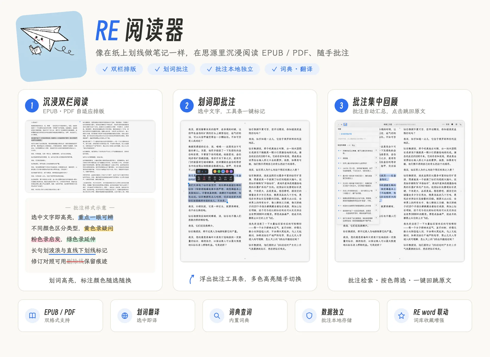

# RE 阅读器（RE Reader）

思源笔记的**独立 EPUB / PDF 阅读器**——像在纸上划线做笔记一样，沉浸阅读、随手批注。



从 [`siyuan-plugin-reword`](https://github.com/LongDarkroom/siyuan-plugin-reword)（RE word 词汇助手）拆出，**独立安装、独立存储、互不依赖**；与主插件并行安装可获得增强联动（见下文）。

## 沉浸阅读

- **EPUB / PDF 双格式**：EPUB 采用 foliate-js 原生排版引擎，PDF 采用 PDF.js 固定版式 + 文本层标注；另支持 TXT / MD
- **排版全可调**：主题、字体、边距、行距、双栏自适应
- **书架管理**：分组、标签、封面、阅读状态（未读/在读/读完）、评分、收藏、进度记忆
- **朗读 TTS**：system / 有道 / Edge / 讯飞多引擎，连续朗读 + 句子高亮
- **阅读统计**：时长累计、连续天数、热力图、Top 书目
- **PDF 能力**：大纲 / 页码跳转、缩放、矩形框选标注

## 划词批注

- **选中即批注**：高亮（多色）/ 直线下划线 / 波浪线，支持 Apple Pencil 墨迹且墨迹持久化
- **批注集中回顾**：批注自动汇总，支持检索、按颜色筛选、一键跳回原文
- **批注数据本地独立存储**（`loadData/saveData`），不依赖任何其他插件

## 查词与翻译

- **划词查词**：离线 MDX / CSV 词典引擎 + 在线词典兜底
- **AI 译文**：多引擎翻译、整章预翻译、双语对照（参考 Readest 双语架构）

## 与 RE word 联动（可选）

本插件与主插件 [RE word 词汇助手](https://github.com/LongDarkroom/siyuan-plugin-reword)**完全独立**，单独使用不受影响。额外安装主插件可获得三项增强：

- 词典卡「加入词库」☆/★（收藏生词）
- 划词「AI 精读」
- 词典弹窗「侧边栏查词」

未安装主插件时，以上三项给出可见降级提示，不影响阅读与批注主体功能。

## 安装

- **集市安装（推荐）**：思源「设置 → 集市 → 插件」中搜索「RE 阅读器」
- **手动安装**：从 [Releases](https://github.com/LongDarkroom/siyuan-plugin-reader/releases) 下载 `package.zip`，解压到工作空间 `data/plugins/siyuan-plugin-reader/`，重启思源后在「设置 → 数据与文件 → 第三方插件」中启用

### 词典导入（重要）

**本插件不含词典实包**（约 77 MB，需自行获取）：

- 方式一：插件内「设置 → 词典 → 导入词典包」，选择 `.mdx` / `.csv` 文件
- 方式二：手动把词典文件放入插件的 `dict/` 目录，重启思源

未导入词典时，划词查词会自动走在线词典。

### 批注数据迁移

首次启动时，若本插件批注库为空、而主插件 `siyuan-plugin-reword` 残存批注数据（`hiword-annotations.json`），会自动一次性迁移到本插件，仅执行一次。

## 开发

```bash
npm install
npm run build     # vite build + copy-dist
npm test          # 行为测试（5 个文件）
npm run verify    # tsc --noEmit + svelte-check
```

### 目录结构

```
src/
├── index.ts              插件入口（addTab / addTopBar / addCommand 同步注册）
├── reader/               阅读器主体（含 vendor/foliate-js EPUB 渲染内核）
│   ├── ReaderView.svelte    主阅读视图（PDF/EPUB 双模式）
│   ├── BookshelfView.svelte 书架
│   ├── reader-dock.ts      书架+设置+字体+页签的控制器
│   ├── reader-settings.ts  阅读设置（主题/字体/边距/排版）
│   └── reader-style.ts     样式生成器
├── dict/                 查词引擎 + DictManager（导入接口）
├── translate/            翻译引擎（6 个 provider + 缓存 + 术语表）
├── ai/                   AI 译文（ai-settings + ai-client + 设置面板）
├── annotation/           批注（本地类型/常量 + 本地持久化 store）
├── core/ i18n/ siyuan/ ui/ utils/ license/   基础模块
└── index.less            全局样式（令牌 + reader-ui + 词典/批注区块）
```

### 与主插件的差异（切分适配）

| 方面 | 主插件 | 本插件 |
|---|---|---|
| 挂载 | dock 组合栏的一个 feature | 独立主区页签 + 顶栏图标 + 命令 |
| 批注 | 数据持有方，store 走 `loadData/saveData` | 同样本地持久化，已从主插件独立（首启自动迁移老数据） |
| 词典 | 词典面板 + 词库联动 | 仅阅读器划词查词 + 自带导入入口 |
| AI | AI 精读对话（`ai-panel`） | 仅 AI 译文（`ai-settings` + `ai-client`） |

## 许可

MIT（沿用主插件）
