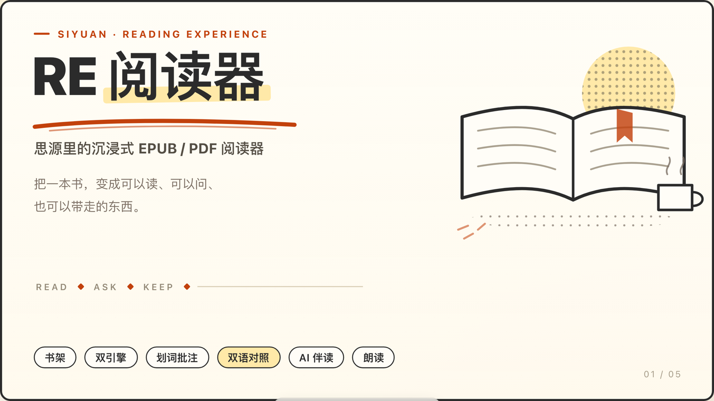
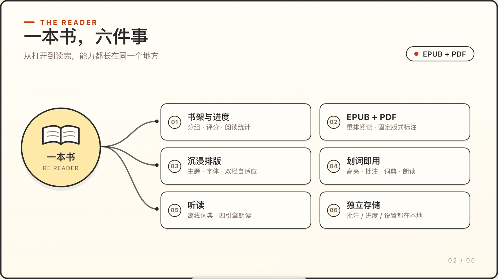
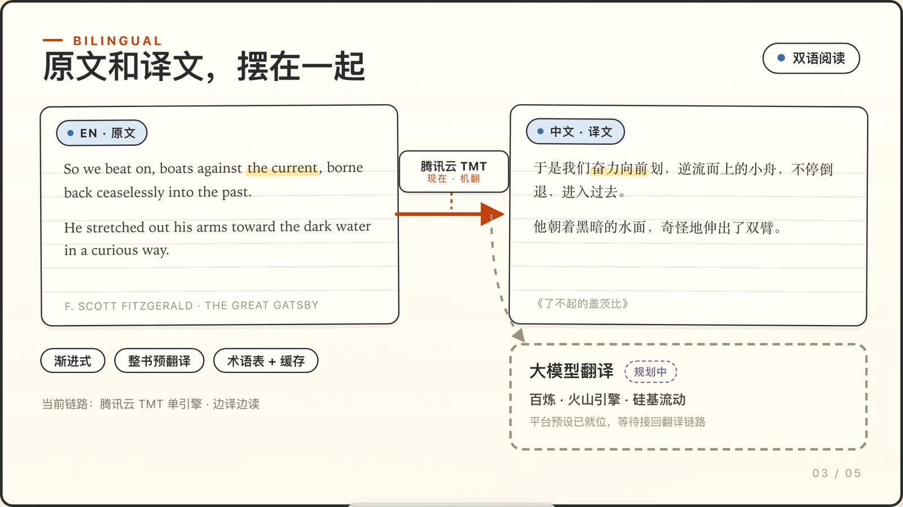
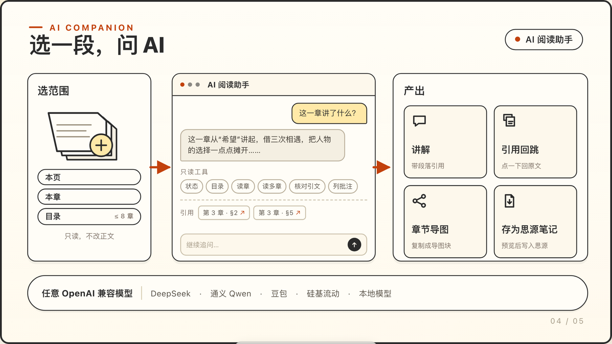
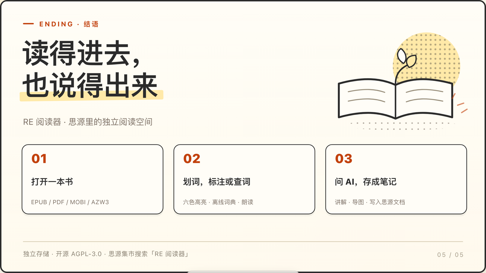

# RE 阅读器

**思源里的沉浸式 EPUB / PDF 阅读器。**

把一本书，变成可以读、可以问、也可以带走的东西。

RE 阅读器把书架、阅读、划词、词典、翻译、朗读和 AI 助手放进思源的独立页签：书在思源里读，批注、进度与设置也留在本地，不依赖其他插件。



> [!NOTE]
> 独立安装、独立存储。批注、阅读进度、阅读设置和 AI 会话都保存在本插件自己的数据目录里。

## 一本书，六件事



| 你想做的事 | RE 阅读器怎么做 |
|---|---|
| 找书、继续读 | 书架分组、标签、封面、评分、收藏；每本书单独记住进度 |
| 读 EPUB 和 PDF | EPUB 重排、PDF 固定版式与文本层标注；也支持 MOBI / AZW3 / FB2 / TXT / MD / CBZ（无 DRM） |
| 调成顺眼的样子 | 主题、字体、字号、边距、行距、双栏自适应 |
| 边读边记 | 六色高亮、直线 / 波浪下划线、Apple Pencil 墨迹批注，跨页选区自动续接 |
| 查词、翻译、听 | 离线 MDX / CSV 词典、腾讯 TMT 机翻与双语对照、四引擎朗读 |
| 把书读成自己的 | AI 按页 / 章 / 目录提问，引用回跳，一键存为思源笔记 |

## 原文和译文，摆在一起



双语不是把整本书先翻完再给你看，而是**边读边译**：正在读的段落优先，缓存命中直接出结果，没命中再走腾讯云 TMT。术语表改动会让相关段落重新翻译，避免同一本书里一个词两种译法。

- **渐进式**：先译正在读的段落，长书不用等
- **整书预翻译**：有空时一次翻完，之后翻页即读
- **术语表 + 缓存**：人名、专有名词统一译法；重复段落不重复计费

> 当前双语链路是腾讯云 TMT 单引擎；大模型翻译在规划中。
>
> 需要自备腾讯云 TMT 的 SecretId / SecretKey，在「设置 → 双语翻译」里填写后启用。

## 选一段，问 AI



阅读助手不是把整本书塞给模型，而是让你先**选范围**：本页、本章，或从目录里挑一段（一次最多 8 章）。助手通过只读工具读取目录、章节、指定范围和批注，**不会改动正文与批注**。

- 回答带**段落引用**，点一下回跳原文；不放心还可以核对引文
- 可以接着追问，也可以让它把这一章讲成**章节导图**
- 满意的话一键**存为思源笔记**，讲解、引用、导图一起带走
- 支持任意 OpenAI 兼容接口：DeepSeek、通义 Qwen、豆包、硅基流动，或本地模型

## 读得进去，也说得出来



1. **打开一本书**：EPUB / PDF / MOBI / AZW3 / FB2 / TXT / MD / CBZ，从书架、顶栏图标或命令进入
2. **划词，标注或查词**：六色高亮、批注、离线词典、翻译、朗读，工具条跟着选区浮出
3. **问 AI，存成笔记**：选中一段问它，回答带引用，一键写入思源文档

## 快速开始

1. 思源「设置 → 集市 → 插件」搜索「RE 阅读器」安装；或从 [Releases](https://github.com/LongDarkroom/siyuan-plugin-reader/releases) 下载 `package.zip`，解压到工作空间 `data/plugins/siyuan-plugin-reader/`，重启思源后在「设置 → 数据与文件 → 第三方插件」中启用
2. 打开书架，导入一本 EPUB / PDF
3. 选中一段文字试试：高亮、查词、翻译、朗读、问 AI

### 词典说明

**本插件不含词典实包**（约 77 MB，需自行获取）：

- 插件内「设置 → 词典 → 导入词典包」，选择 `.mdx` / `.csv` 文件
- 或把词典文件放入插件的 `dict/` 目录，重启思源

未导入词典时，划词查词会自动走在线词典。

## 社区与反馈

使用问题与功能建议，欢迎来这里交流；如果 RE 阅读器帮你省下了时间，也欢迎到爱发电支持它继续更新。

| 渠道 | 地址 |
|---|---|
| B 站 | [微光突围](https://space.bilibili.com/39780528) |
| QQ 群 | **123795105** |
| 爱发电 | [支持开发](https://afdian.com/a/3435d) |

赞助不是使用条件：功能对所有人一样完整，也不影响答疑顺序。

## 数据与许可

- **独立存储**：批注、进度、阅读设置、AI 会话保存在插件自己的数据目录，不依赖其他插件
- **开源**：源码以 **AGPL-3.0-or-later** 发布，许可证全文见仓库 `LICENSE`，第三方组件声明见 `THIRD-PARTY-NOTICES.md`

## 开发

```bash
npm install
npm run build     # vite build + copy-dist
npm test          # 行为测试
npm run verify    # tsc --noEmit + svelte-check
```
