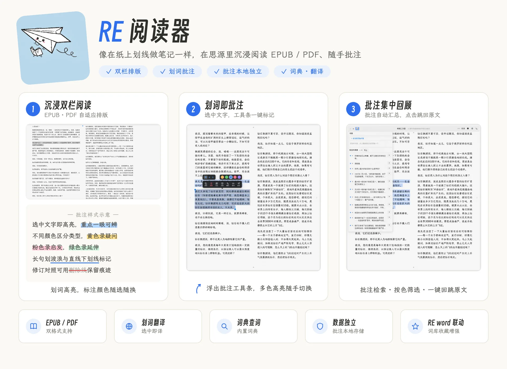
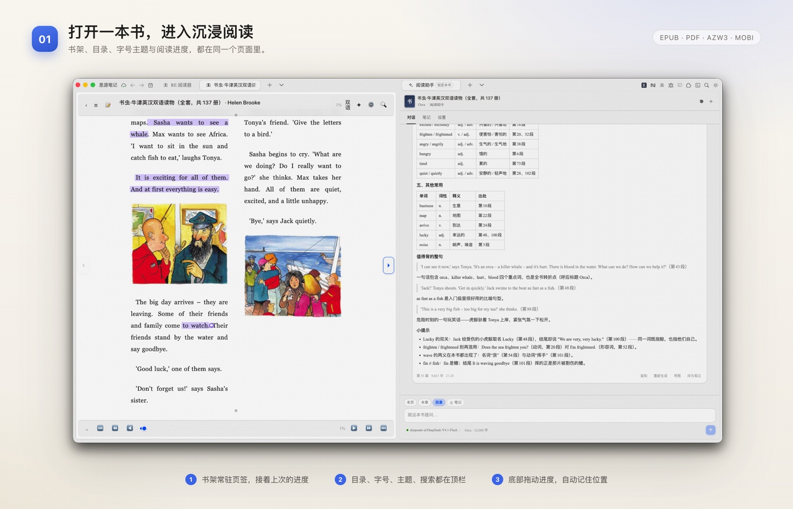
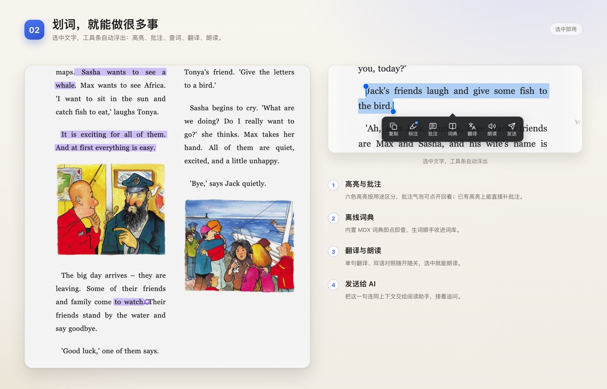
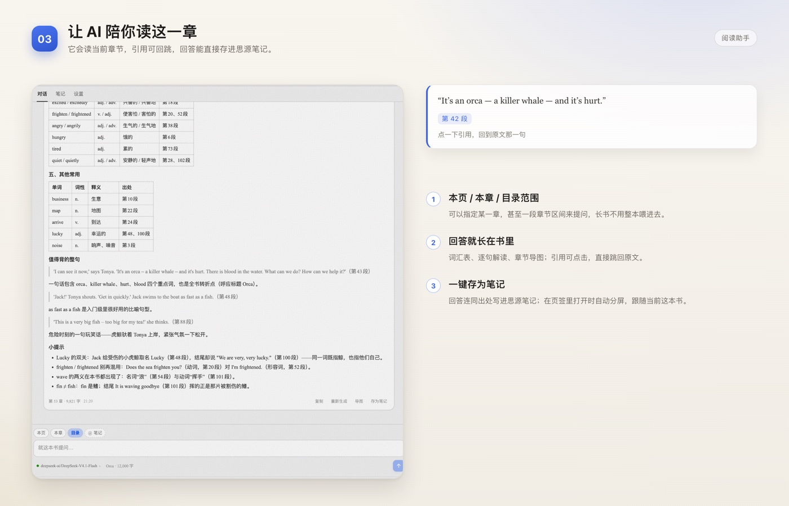

# RE 阅读器（RE Reader）

思源笔记的**独立 EPUB / PDF 阅读器**：书架、沉浸排版、划词批注、离线词典、双语对照，还有一个能读章节的 AI 阅读助手。



**独立安装、独立存储**：批注、进度、阅读设置、AI 会话全部保存在本插件自己的数据目录里。

## 三步用起来

### 1. 打开一本书，进入沉浸阅读



- 从右侧栏、顶栏图标或命令打开阅读器；书架记住上次的分组、筛选与每本书的进度
- 目录、字号、主题、搜索收在顶栏一行；底部拖动进度条即翻页，位置自动保存
- EPUB 重排（foliate-js）、PDF 固定版式（PDF.js 文本层）、TXT / MD 都能读

### 2. 划词，就能做很多事



- 选中文字，工具条自动浮出：复制、标注、批注、词典、翻译、朗读、发送给 AI
- 六色高亮 + 直线 / 波浪下划线，批注气泡点开回看；跨页选区自动续接
- 离线 MDX / CSV 词典即点即查；单句翻译与双语对照；多引擎朗读

### 3. 让 AI 陪你读这一章



- 停靠栏与独立页签两种形态：自动跟随当前书，也可以锁定
- 提问范围可选**本页 / 本章 / 目录指定章节**，长书不用整本喂进去
- 回答带段落引用，点一下回到原文；可一键存为思源笔记，附带词汇表、逐句解读与章节导图
- AI 通过只读工具读取目录、章节、指定范围、核对引文、列出批注，**不会改动原文与批注**

## 功能

### 阅读

- **EPUB / PDF 双引擎**：EPUB 用 foliate-js 原生排版，PDF 用 PDF.js 固定版式 + 文本层标注
- **排版可调**：主题、字体、边距、行距、双栏自适应
- **书架管理**：分组、标签、封面、阅读状态、评分、收藏、进度记忆
- **阅读统计**：时长累计、连续天数、热力图、Top 书目
- **PDF 能力**：大纲 / 页码跳转、缩放、矩形框选标注

### 批注

- 高亮（六色）/ 直线下划线 / 波浪线，Apple Pencil 墨迹且持久化
- 批注集中回顾：检索、按颜色筛选、一键跳回原文
- 批注、进度、设置全部本地存储（`loadData/saveData`），不依赖其他插件

### 查词与翻译

- 划词查词：离线 MDX / CSV 词典引擎 + 在线词典兜底
- 翻译：腾讯机器翻译、整书预翻译、双语对照（参考 Readest 双语架构）

### AI 阅读助手

- 支持任意 OpenAI 兼容接口（DeepSeek 等），流式输出
- 阅读工具：当前状态、目录、读一章、读多章、核对引文、列批注
- 会话历史、重新生成、引用回跳、存为笔记、章节导图

### 朗读

- system / 有道 / Edge / 讯飞多引擎，连续朗读 + 句子高亮跟随

## 安装

- **集市安装（推荐）**：思源「设置 → 集市 → 插件」中搜索「RE 阅读器」
- **手动安装**：从 [Releases](https://github.com/LongDarkroom/siyuan-plugin-reader/releases) 下载 `package.zip`，解压到工作空间 `data/plugins/siyuan-plugin-reader/`，重启思源后在「设置 → 数据与文件 → 第三方插件」中启用

### 词典导入（重要）

**本插件不含词典实包**（约 77 MB，需自行获取）：

- 方式一：插件内「设置 → 词典 → 导入词典包」，选择 `.mdx` / `.csv` 文件
- 方式二：手动把词典文件放入插件的 `dict/` 目录，重启思源

未导入词典时，划词查词会自动走在线词典。

## 开发

```bash
npm install
npm run build     # vite build + copy-dist
npm test          # 行为测试
npm run verify    # tsc --noEmit + svelte-check
```

### 目录结构

```
src/
├── index.ts              插件入口（addTab / addTopBar / addCommand 同步注册）
├── reader/               阅读器主体（含 vendor/foliate-js EPUB 渲染内核）
│   ├── ReaderView.svelte    主阅读视图（PDF/EPUB 双模式）
│   ├── BookshelfView.svelte 书架
│   ├── reader-dock.ts      书架+设置+字体+页签的控制器
│   ├── reader-settings.ts  阅读设置（主题/字体/边距/排版）
│   └── reader-style.ts     样式生成器
├── ai/                   AI 阅读助手（面板、页签、会话、工具、导图）
├── dict/                 查词引擎 + DictManager（导入接口）
├── translate/            翻译引擎（多 provider + 缓存 + 术语表）
├── annotation/           批注（类型/常量 + 本地持久化 store + 渲染）
├── core/ i18n/ siyuan/ ui/ utils/ license/   基础模块
└── index.less            全局样式
```

## 许可

MIT
